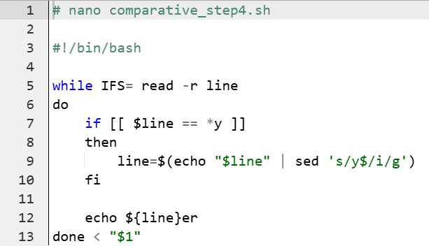

## **Introduction**

This course, _Essential Tools for Language Technology_, or previously known as _Command Line Tools for Linguists_, is aimed for those
who are eager to learn the basic and most essential command line tools used in language technology. On this course you will learn, 
for example, to operate in a Unix-like environment, process text data, run programs and use remote servers and version control tools. 
As a final project you will learn the basics of web page development.

The link to the course page:  
[Essential Tools for Language Technology](https://studies.helsinki.fi/courses/course-unit/otm-c13d30ee-e5cc-4e1c-b8b3-67883288b9a4/KIK-LG221?cpId=hy-lv-77)

### **Module 1**

In this module, we explored the basics of command line tools. We set up the environment and got to know some basic commands, as well 
as the the basic structure of the Unix environment. Learning these has proven to be very useful throughout the course.

The table shows some important commands:

| for directories                      | for (text) files                      | others                                    |
|:------------------------------------:|:-------------------------------------:|:-----------------------------------------:|
| `mkdir` (make a directory)           | `cp` (copy a file)                    | `ls` (list files and directories)         |
| `rm -R` (remove non-empty directory) | `mv` (move or rename files)           | `pwd` (print working directory)           |
| `cd` (change the working directory)  | `nano` (open a file in a text editor) | `echo` (writes to files or echoes a text) |

### **Module 2**

In this module, we focused on text processing. We learned some regular expressions (RegEx), character encodings and the essential 
commands for manipulating text files.

Here is an example of piped text processing commands:  
```bash
cat life_of_bee.txt | dos2unix | sed 's/^$/#/' | tr '\n' ' ' | sed -E 's/([.?!]) ([A-Z])/\1# \2/g' | sed -E 's/([IVX][.])#/\1/g' 
| tr '#' '\n' | sed 's/^ *//' | sed 's/ *$//' | grep -v "^$" | less
```
This takes the file life\_of\_bee.txt, converts the format, uses `sed` for text/character subtitution, `tr` for replacing characters 
and `grep` for searching and removing characters. The outcome is the text transformed into one sentence per line format.

I also learned to create a frequency list, remove duplicates and find n-grams, which I think are a few good examples of important 
tasks in text processing and working with corpora.

### **Module 3**

This module focused on creating bash scripts, installing programs and familiarising yourself with the permissions and privileges in 
your environment.

 On the picture you can see an example 
of a **bash script** under the name comparative_step4.sh. The script takes a text file as an argument, reads it line by line and prints 
the comparative form of each adjective. This was one of our tasks in the module quiz.

I learned more deeply about the structure of the command line environment, for example about paths, variables and how to modify 
the environment to my needs. I also got acquainted with the root user command `sudo` and the package managers `apt-get` and `pip`.

### **Module 4**

This module was all about version control and remote servers. The list below presents and explains the key concepts of the module.

1. ssh
   * connect to a remote server
      * `ssh roihu-gpu.csc.fi`
2. scp
   * "secure copy protocol"
   * copy files/directories over ssh connections
3. git
   * a distributed version control system
   * an essential command when working in remote servers
      * `git add`
      * `git commit`
      * `git push`
4. Jekyll[^1]
   * "a static site generator written in Ruby"
   * "adopted by GitHub"
5. GitHub[^2]
   * "developer platform that allows developers to create, store, manage, and share their code"
   * "uses Git to provide distributed version control"

### **Final Assignment**

This web page is the visual embodiment of the final project and the epitome of everything I have learned during the course. Even 
though this project turned out to be quite a lot of work, I have really enjoyed making this and found this project very interesting. 
I feel like this project solidified all of the key themes I have learned.


_____

[^1]:[Jekyll Wikipedia](https://en.wikipedia.org/wiki/Jekyll_(software))
[^2]:[GitHub Wikipedia](https://en.wikipedia.org/wiki/GitHub)
