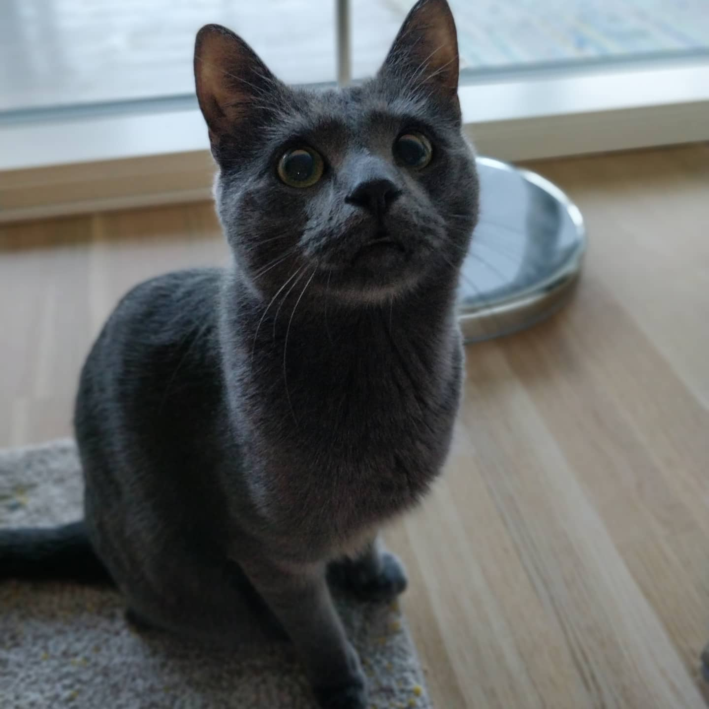

## Introduction

 My name is Vesa-Katti Loiri, or more commonly Vesku. I am a seven-year-old cat with a very soft grey fur. I was named after the famous Finnish actor/musician Vesa-Matti Loiri. I am a  happy and a little timid cat and I love food and snacks. Currently I live in Turku in South-West Finland.

## Find me on

[GitHub](https://github.com/Anontides), [Instagram](https://www.instagram.com/vesa_katti_loiri/)

## Contact

My email address is notmyaddress@helsinki.fi. 

## Courses I've Taken

Here is a list of all language technology courses I have taken

[Introduction to Language Technology](https://studies.helsinki.fi/courses/course-unit/otm-96b452f8-1f60-4696-8f0e-50559973b315), fall 2025

[Programming for Linguists](https://studies.helsinki.fi/courses/course-unit/otm-211905a1-e420-4ece-b6a5-978b56aa8851), fall 2025

[Mathematics for Linguists](https://studies.helsinki.fi/courses/course-unit/otm-78ac8520-fe65-4b8a-9017-a76711c08adf), spring 2026

## Projects

### GitHub project for Command Line Tools course  
[Here](https://github.com/Anontides/Anontides.github.io) is the link to my GitHub page for this project. You are currently reading the outcome of the project. The objective was to create a webpage about and for ourselves utilizing all the knowledge we have learned on the course.

## Misc.

